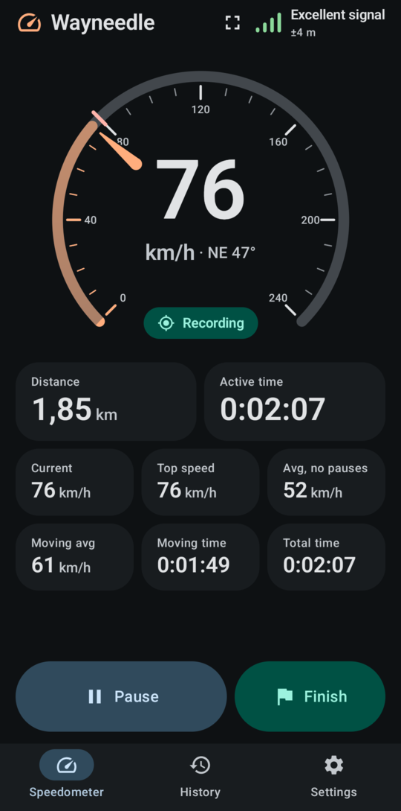
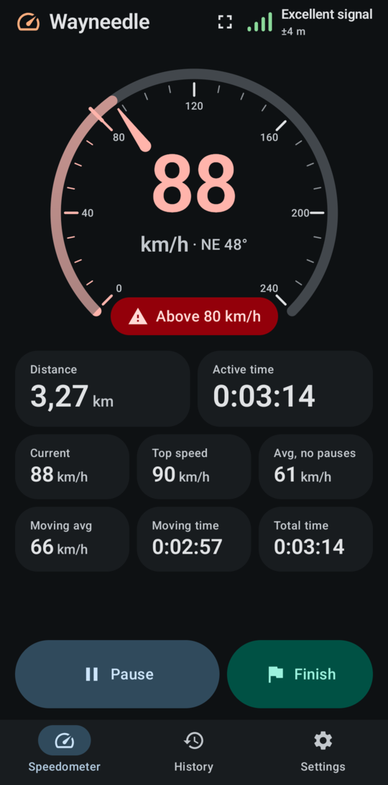
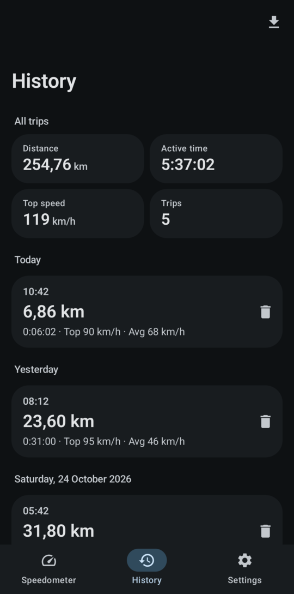
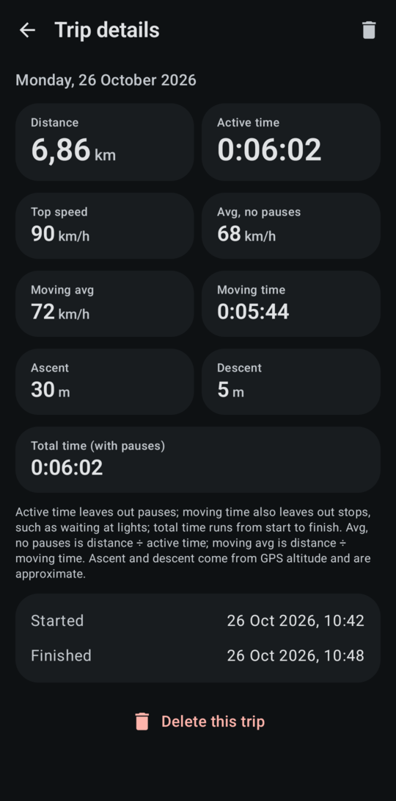
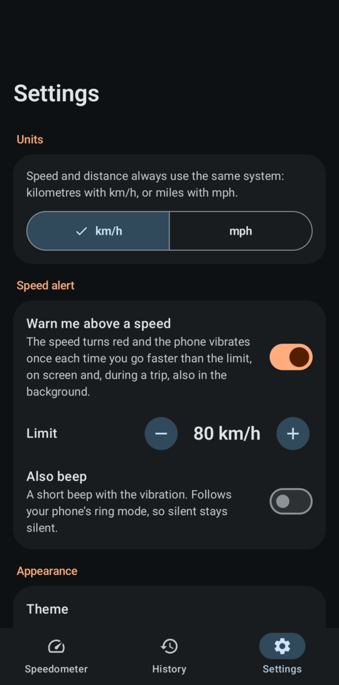

<p align="center">
  
</p>

# Wayneedle – GPS Speedometer & Trip Tracker for Android (offline, open source)

[](https://github.com/riyadmondol2006/Wayneedle/releases/latest)
[](LICENSE)
[](#requirements)
[](#toolchain)
[](#architecture)
[](https://github.com/riyadmondol2006/Wayneedle/actions/workflows/release.yml)

**Wayneedle is a free, open-source GPS speedometer and trip computer for Android.** It shows your live speed in
km/h or mph on a large analog-and-digital speedometer, records trips (distance, top speed, average and moving
average, active, moving and total time, climb and descent), warns you above a speed limit you choose, and has a
HUD mode for the windscreen. It works **fully offline** – no mobile data, no account, no ads, no tracking – and
keeps every trip on your phone.

Use it as a car speedometer, a cycling computer, a running or hiking speed tracker, an odometer for a road trip, or
to check your real speed against the car's speedometer.

[Download the latest APK](https://github.com/riyadmondol2006/Wayneedle/releases/latest) ·
[Screenshots](#screenshots) · [Features](#features) · [FAQ](#faq) · [Privacy](#privacy) ·
[Build from source](#building)

## Screenshots

<table>
  <tr>
    <td align="center"><br><b>Live speed and trip computer</b></td>
    <td align="center"><br><b>Speed alert</b></td>
    <td align="center"><br><b>HUD mode</b></td>
  </tr>
  <tr>
    <td align="center"><br><b>History and lifetime totals</b></td>
    <td align="center"><br><b>Trip details</b></td>
    <td align="center"><br><b>Settings</b></td>
  </tr>
</table>

<sub>Real screenshots from a Google Pixel 6 Pro (Android 17, dark theme, brand colours). The trip was driven with
scripted GPS fixes, and the earlier trips in History are sample data; only the phone's status bar was cropped.
Numbers follow the phone's language settings, here with a decimal comma.</sub>

## Features

### Speedometer

* **Live GPS speed** in km/h or mph, whenever the app is open, with or without a trip. Reads the speed the GPS
  receiver measures itself (Doppler), so it reacts quickly and does not jitter while you stand still.
* **Large dial and digits** built for a phone mount, with the course shown while moving ("km/h · NE 47°").
* **Honest when there is no signal**: no fix means "no speed", never a made-up 0 km/h. A GPS signal indicator shows
  quality, accuracy and satellites; tap it for **GPS details** (position and speed accuracy, altitude, heading).
* **HUD mode**: full-screen white-on-black speed with an optional mirror image for reading in the windscreen at
  night.

### Trip computer

* **Start, pause, resume and finish trips.** Each trip records:
  * distance and top speed (held across two GPS readings, so one glitch never becomes your record);
  * **average speed without pauses** and **moving average** (stops at lights left out);
  * **active time** (pauses left out), **moving time** (stops left out too) and **total time** (start to finish);
  * **ascent and descent** from GPS altitude (approximate).
* **Keeps distance through tunnels and underground car parks**: the straight line across a GPS gap is counted once
  the signal returns.
* **History** with lifetime totals and **CSV export** (spreadsheet-friendly, your choice of folder).

### Safety and convenience

* **Speed alert**: above your limit the speed turns red, the limit is marked on the dial and the phone vibrates
  once (optionally beeps) per crossing – on screen and, during a trip, also in the background.
* **Keep screen on** while you are moving, then the normal screen timeout to save battery.
* **Material You** colours on Android 12+, light and dark themes, large-text and TalkBack support.

### Reliable in the background

* **Records with the screen off** and the app closed, through a foreground service with Pause/Resume in the
  notification. Verified with the phone in deep Doze.
* **Never loses a trip**: if Android kills the app or the battery dies, the trip comes back paused; a new trip
  started first files the interrupted one into History.
* **Tells you what would stop it**: warnings when battery use is restricted, Battery Saver turns GPS off with the
  screen off (you can close this one), notifications are blocked, or Android refuses background recording.

### Private by design

* No accounts, no analytics, no crash reporters, no ads, no third-party SDKs, no cloud backup.
* Location is used only on the phone; trips store summary numbers, never coordinates or routes.
* The only network use is the optional daily **update check** against this GitHub repository (see [Privacy](#privacy)).

## Download and updates

Get the signed APK from [GitHub Releases](https://github.com/riyadmondol2006/Wayneedle/releases/latest) and open it
on your phone (Android asks you to allow installing from your browser or file manager once). Each release lists a
SHA-256 checksum of the APK.

The app checks GitHub once a day for a newer release and offers it in a popup; switch this off in
Settings › Updates. Every push to `main` builds and publishes a new signed release automatically
([docs/RELEASING.md](docs/RELEASING.md)).

## FAQ

**Does Wayneedle work offline, without mobile data or Wi‑Fi?**
Yes. GPS works without any network, and so does everything in the app: speed, trips, history, export. Only the
optional update check needs a connection.

**Does it need the internet permission?**
Only for the update check, which sends nothing about you or your trips. Automated tests make sure that no other part
of the app can use the network and that it can only contact this repository's GitHub addresses.

**How accurate is the GPS speed?**
In open sky, phone GPS speed is usually within 1–2 km/h. The receiver's own estimate for each reading is shown in
GPS details, and readings that are too uncertain, stale or physically implausible are ignored. It can differ from a
car's speedometer, which usually reads a little high by design. Accuracy while moving has not been measured for this
project yet (see [Status](#status-and-verification)); [How speed is measured](#how-speed-is-measured) explains the method.

**Does it work in the background or with the screen off?**
Yes, during a trip. A foreground service with a notification keeps GPS and recording alive; this was tested with
the screen off and the phone forced into deep Doze. If your phone restricts the app, the dashboard tells you how to fix it.

**How much battery does it use?**
GPS is the main cost. In a 5-minute screen-off test on a Pixel 6 Pro, Android attributed 1.65 mAh to the app
(about 0.4 % of the battery per hour). With the screen on, the display costs far more than the app; "keep screen on"
therefore only holds the display while you move.

**Why does it need location permission, and why "precise"?**
Speed comes from the GPS receiver, which Android only provides with precise location. The app asks only for
"while using the app"; background recording works through the visible trip notification.

**Can I export my trips?**
Yes: History › export writes a CSV file (times, distance, speeds, durations, climb) wherever you choose.

**Is there an iPhone version?**
No, Wayneedle is Android only.

## How speed is measured

Wayneedle reads the speed that the phone's GPS receiver reports for each fix (`Location.getSpeed()`, in metres per
second) and multiplies by 3.6 to get km/h (mph uses 2.2369). That value is the speed the receiver itself reports (on
most GNSS chips it is derived from the Doppler shift of the satellite signals), not the distance between two
positions divided by the time between them, so it responds quickly and does not jitter while you stand still.

Not every fix is trusted. A fix is ignored when, for example, its position accuracy is poor, it is stale or out of
order, it carries no speed, or the jump from the previous fix is physically implausible. Very small speeds are
treated as standing still, and tiny position changes inside the receiver's noise level do not add distance, so a
phone lying on a table does not collect kilometres. When no reliable fix exists the speedometer says so instead of
guessing. The exact thresholds are documented in the tracking engine's source and summarised in
[docs/ARCHITECTURE.md](docs/ARCHITECTURE.md).

Trip distance is the sum of the distances between consecutive accepted fixes while the trip is running. After
starting or resuming, the first accepted fix only sets the starting point. When the GPS drops out while you keep
moving (a tunnel, an underground garage, a street between tall buildings), the straight line across the gap is
counted once the next fix confirms where you came out, even if you are standing at a traffic light by then; a first
fix after a gap that is clearly wrong adds nothing.

**Averages and times.** Active time leaves out pauses; moving time also leaves out stops while recording (the
stretches that added no distance). "Avg, no pauses" is distance ÷ active time; "Moving avg" is distance ÷ moving
time. Total time runs from start to finish, pauses included.

**Top speed** is the highest speed held across two consecutive GPS fixes (about two seconds), taking the lower of
the two. A single glitched reading, which receivers produce now and then, therefore never becomes a trip's record.

**Ascent and descent** use the GPS altitude of moving fixes with good vertical accuracy, counted in steps of at
least 5 m so altitude noise does not add up. Phone altitude is less precise than position; treat them as estimates.

Speed measured this way needs the **precise** location permission. If you grant only approximate location, the app
tells you that it cannot measure speed.

## Requirements

* A device running Android 8.0 (API 26) or newer with a GPS receiver. The app installs without GPS hardware and then
  reports that it has no GPS.
* To build: JDK 17 or newer and the Android SDK (see [Building](#building)).

## Toolchain

| Component | Version |
|---|---|
| Gradle (wrapper) | 9.8.2 |
| Android Gradle Plugin | 9.4.1, using its built-in Kotlin support (`org.jetbrains.kotlin.android` is not applied) |
| Kotlin | 2.4.21 (the Compose compiler plugin uses the same version) |
| KSP | 2.3.12 |
| Compose BOM | 2026.09.00 |
| Material 3 | 1.4.0 (stable; Expressive components are public only in 1.5 pre-releases) |
| Room | 2.8.5 (schema 2) |
| DataStore | 1.3.0 |
| Kotlin coroutines | 1.11.0 |
| JDK | 17 or newer (bytecode target 17; CI uses Temurin 17) |
| Min SDK | 26 |
| Target and compile SDK | 37 |
| Style checks | ktlint 1.8.0 through Spotless 8.10.4 |

Every version is an exact, stable release; the version catalog is [gradle/libs.versions.toml](gradle/libs.versions.toml).

## Building

1. Install a JDK, version 17 or newer, and make sure `java -version` finds it.
2. Install the Android SDK with Platform 37 (minor version 2, package `platforms;android-37.2`) and accept its
   licences, for example with Android Studio's SDK Manager or
   `sdkmanager "platforms;android-37.2"` and `sdkmanager --licenses`. Gradle can download missing components once
   the licences are accepted.
3. Tell Gradle where the SDK is: set `ANDROID_HOME`, or create `local.properties` in the repository root
   (it is git-ignored):

   ```properties
   sdk.dir=/path/to/Android/Sdk
   ```

4. Build the debug APK:

   ```sh
   ./gradlew assembleDebug
   ```

   The APK is written to `app/build/outputs/apk/debug/app-debug.apk`. The debug build uses the application id
   `app.wayneedle.debug` so it can sit next to a release build.

Release builds enable R8 shrinking. They are signed only when the signing variables are set; the release workflow
does that with repository secrets ([docs/RELEASING.md](docs/RELEASING.md)). Never commit a keystore.

The wrapper downloads Gradle 9.8.2 and verifies its checksum. The first build downloads dependencies from Google's
Maven repository and Maven Central, so it needs a network connection.

## Testing

```sh
./gradlew testDebugUnitTest   # JVM unit and architecture tests (no device needed)
./gradlew lintDebug           # Android Lint, warnings are errors
./gradlew staticAnalysis      # ktlint style check (Spotless) plus Android Lint
./gradlew spotlessApply       # fix formatting problems automatically
```

* The Kotlin compiler also treats warnings as errors.
* **JVM tests** cover the tracking engine, the domain rules and the repository's own hygiene rules (network use
  confined to the update check, no Java sources, layering, pinned stable versions, a migration for every database
  version, and more), plus a seeded **chaos test** that plays 150 simulated users through 250 random steps each:
  button mashing, slow and failing storage, the process dying at any moment, GPS glitches and gaps.
* **Instrumentation tests** (`connectedDebugAndroidTest`) are device tests. The maintainers verify on a
  **Google Pixel 6 Pro** and nowhere else: no emulator is used for the project's own validation, and other
  phones attached to a maintainer's machine are never touched. The procedure, the safety scripts and the results log
  are in [docs/TESTING.md](docs/TESTING.md).

### Status and verification

This section is only updated with results that are recorded in [docs/TESTING.md](docs/TESTING.md).

* On a development machine: the debug sources compile with warnings as errors, 473 JVM tests pass, and Android Lint
  and the ktlint check pass.
* On GitHub: the CI and release workflows passed on their first run, and the release workflow published a signed
  `v1.0.1` whose signature it verified with `apksigner`.
* On a Google Pixel 6 Pro (Android 17) on 2026-10-26: all 97 instrumentation tests pass, including recording with
  the screen off in forced deep Doze, the database migration from schema 1 to 2, the HUD screen and closing the
  Battery Saver warning. By hand: the
  speed alert (red dial and one vibration per crossing, also from the background), CSV export through the system
  file picker, lifetime totals, the double-tap guard, the notifications-off warning, rotation keeping the GPS
  listener, keep-screen-on only while moving, recovery of a trip across an app update, heading, GPS details, HUD
  mode, a real update check against GitHub, two minutes stationary with a real satellite fix (0.00 km recorded), and
  a 5-minute screen-off battery measurement. Moving trips used **scripted fixes**, not satellite measurements.
* **Not yet verified**: speed and distance accuracy with real satellites while moving (walking, driving, tunnels),
  long trips, Task Manager "Stop", swiping the notification away on Android 17, and the update popup with a real
  published release.
* No other device models, Android versions or emulators have been tested.

## Project structure

```
app/
  src/main/kotlin/app/wayneedle/
    domain/        Contracts: models and interfaces. Pure Kotlin.
    tracking/      GPS and trip engine. Pure Kotlin except tracking/platform (the LocationManager adapter).
    data/          Room database, DataStore settings, repositories, trip checkpoint store.
    alert/         Speed alert logic and feedback, shared by the UI and the service.
    update/        The update check, the only code allowed to use the network.
    permissions/   Location and notification permission handling.
    service/       Foreground service and notification.
    ui/            Compose UI, theme, view models, navigation, HUD.
    AppContainer.kt, WayneedleApplication.kt   Manual dependency wiring.
  src/test/        JVM unit tests, architecture tests, the chaos test, fixtures and fakes.
  src/androidTest/ Device tests (run only on the reference device).
  schemas/         Exported Room schemas (tracked).
docs/              Architecture, testing and release documentation.
scripts/           Device-safety scripts for the maintainers' Pixel 6 Pro.
.github/workflows/ CI and the signed release workflow.
```

## Architecture

A single Gradle module with strict package layering. The domain and tracking packages contain no Android imports
so the engine is tested on the JVM. Exactly one component, the `TrackingController` implementation, ever subscribes
to the GPS; the UI, the service and the notification only observe its state and send it commands. Details,
including the trip state machine and the persistence rules, are in [docs/ARCHITECTURE.md](docs/ARCHITECTURE.md).

## Privacy

Location is used on the device to compute speed and trip statistics and for nothing else. Trips are stored
locally as summary numbers (no coordinates), excluded from cloud backup, and never sent anywhere. The only network
request the app makes is the optional daily update check to `api.github.com` for this repository's latest
release; it carries no identifier, location or trip data. The full explanation, including why a notification is
shown while a trip records and how to delete your data, is in [PRIVACY.md](PRIVACY.md).

## Contributing

Contributions are welcome. Read [CONTRIBUTING.md](CONTRIBUTING.md) first; the main rules are Kotlin only, no new
network use, no analytics, and tests for behaviour changes. Please follow the [Code of Conduct](CODE_OF_CONDUCT.md).
Report security problems as described in [SECURITY.md](SECURITY.md).

## License

Copyright 2026 Wayneedle contributors.

Licensed under the Apache License, Version 2.0. See [LICENSE](LICENSE) and [NOTICE](NOTICE).
